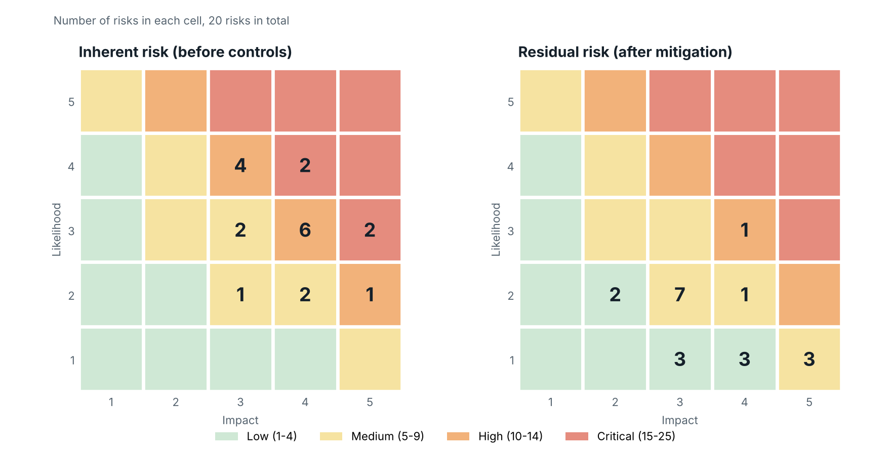
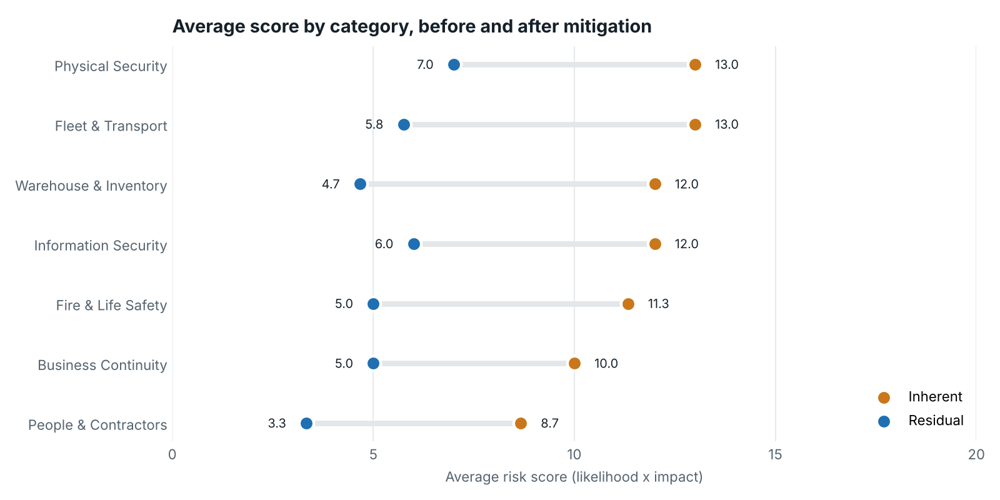

# Security Risk Register

A working security risk register for a logistics site, built the way I ran risk assessments in the field: identify the threat, score it, put a control and an owner against it, and track it until the residual risk is acceptable.

The site is fictional and **all data is synthetic**. The method, the scoring and the structure are the ones I use with consulting clients.



## The site

**Site ALPHA** is a regional distribution centre with a 40-truck fleet yard, loading docks, high-value storage and night transport runs. The register covers 20 risks across 7 categories:

| Category | Examples |
|---|---|
| Physical Security | Gate control, perimeter, CCTV coverage, access cards |
| Fleet & Transport | Cargo theft in transit, driver fatigue, breakdowns, fuel misuse |
| Warehouse & Inventory | Insider theft, FEFO compliance, forklift safety |
| Fire & Life Safety | Battery charging fires, blocked exits, evacuation readiness |
| People & Contractors | Guard vetting, gate disputes, contractor failure |
| Information Security | Shipment schedules leaking through personal apps |
| Business Continuity | Power outages, road closures |

## Results

| | Inherent | Residual |
|---|---:|---:|
| Critical | 4 | 0 |
| High | 11 | 1 |
| Medium | 5 | 11 |
| Low | 0 | 8 |
| **Average score** | **11.6** | **5.3** |

The planned controls cut the total risk score by **54%** and remove every Critical risk. Two actions are overdue as of 1 Oct 2026 and are flagged automatically.



Full output: [`outputs/summary.md`](outputs/summary.md)

## What is in the repo

```text
security-risk-register/
├── risk_register.xlsx          Excel register: formulas, heat map and summary tabs
├── data/
│   └── risk_register.csv       Raw register, one row per risk
├── analysis/
│   └── risk_analysis.py        Scores the register and builds the charts and summary
├── outputs/
│   ├── heatmap_inherent_vs_residual.png
│   ├── score_by_category.png
│   └── summary.md
└── docs/
    └── methodology.md          Scales, rating bands and how to use the register
```

### The Excel workbook

| Tab | What it does |
|---|---|
| **Read Me** | Likelihood and impact scales, rating bands, and the as-of date |
| **Risk Register** | One row per risk. Scores, ratings, reduction and overdue flags are formulas |
| **Heat Map** | 5×5 matrices for inherent and residual risk, counted live from the register |
| **Summary** | Headline numbers, risks by rating, by category and by mitigation status |

Likelihood and impact cells only accept 1 to 5, status is a drop-down, and there are blank rows ready for new risks. Change the as-of date and the overdue flags update.

## Method

- **Score** = Likelihood (1–5) × Impact (1–5)
- **Rating bands:** Low 1–4 · Medium 5–9 · High 10–14 · Critical 15–25
- **Inherent risk** is scored with existing controls only. **Residual risk** is scored assuming the mitigation action is complete.
- An action is **overdue** when its due date has passed and its status is not Done.

Details and scale definitions: [`docs/methodology.md`](docs/methodology.md)

## Run the analysis

```bash
pip install -r requirements.txt
python analysis/risk_analysis.py --as-of 2026-10-01
```

The script reads `data/risk_register.csv`, checks every score is between 1 and 5, and writes the two charts and `summary.md` to `outputs/`.

## About

Built by **Sherief Nooh**, security and logistics operations professional and former Major in the Egyptian Ministry of Interior.

[Portfolio](https://sherief-nooh.github.io) · [LinkedIn](https://www.linkedin.com/in/sherief-nouh/) · [GitHub](https://github.com/sherief-nooh)
